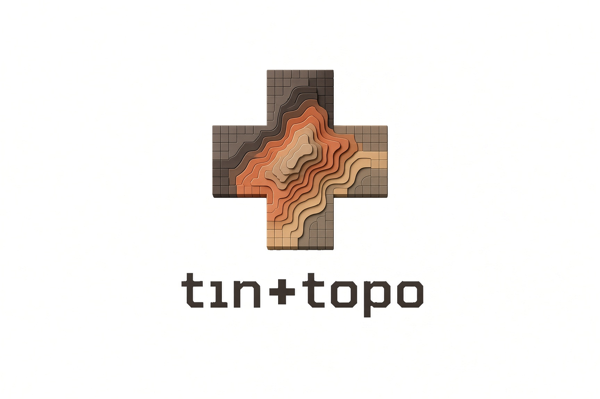

  

  
  
  

  

## Welcome to the `tin+topo` Hub

This is the central GitHub space for `tin+topo`, where we share maps, apps, and open-source code to the greater geospatial community.

Our mission is to:
- Create beautiful and actionable static and interactive maps.

## Our Work

This organization is managed by Colin Stiles. For official inquiries, please visit our [public website](https://www.tinandtopo.com).

A recent map from the [2026 map challenge](https://challenge.colinstiles.com/).

  

## Featured Repositories

Here are a few of our key open-source projects.

| Repository | Description |
| :--- | :--- |
| **[tt-template](https://github.com/tin-and-topo/tt-template)** | Our standard project template for reproducible GIS and data science work. |
| **[tt-chattanooga-crime](https://github.com/tin-and-topo/tt-chattanooga-crime)** | Chattanooga crime statistics. |
| **[.github](https://github.com/tin-and-topo/.github)** | The central repository for our organization's community health files and templates. |

## How to Contribute

We welcome contributions and suggestions! The best way to engage is to open an issue to discuss a bug or new idea.

- 📝 **[Suggest a feature or enhancement](https://github.com/tin-and-topo/.github/issues/new?assignees=&labels=enhancement&template=feature_request.yml&title=%5BFeature%5D%3A+)**
- 🐛 **[Report a bug or an error](https://github.com/tin-and-topo/.github/issues/new?assignees=&labels=bug&template=bug_report.yml&title=%5BBug%5D%3A+)**

Please review our **[Contributing Guidelines](https://github.com/tin-and-topo/.github/blob/main/CONTRIBUTING.md)** before opening a pull request.

## Recent Stories

- <a href="https://medium.com/@colintimothystiles/case-study-mapping-geohazards-in-the-philippines-731823f61772" target="_blank">(Medium) GIS Case Study: Mapping Geohazards in the Philippines</a>

- <a href="https://medium.com/@colintimothystiles/arcgis-pro-python-analyzing-land-cover-change-in-major-global-urban-centers-6affacdb6d78" target="_blank">(Medium) ArcGIS Pro & Python: Analyzing Land Cover Change in Major Global Urban Centers</a>

## Connect

  
  
  
  
